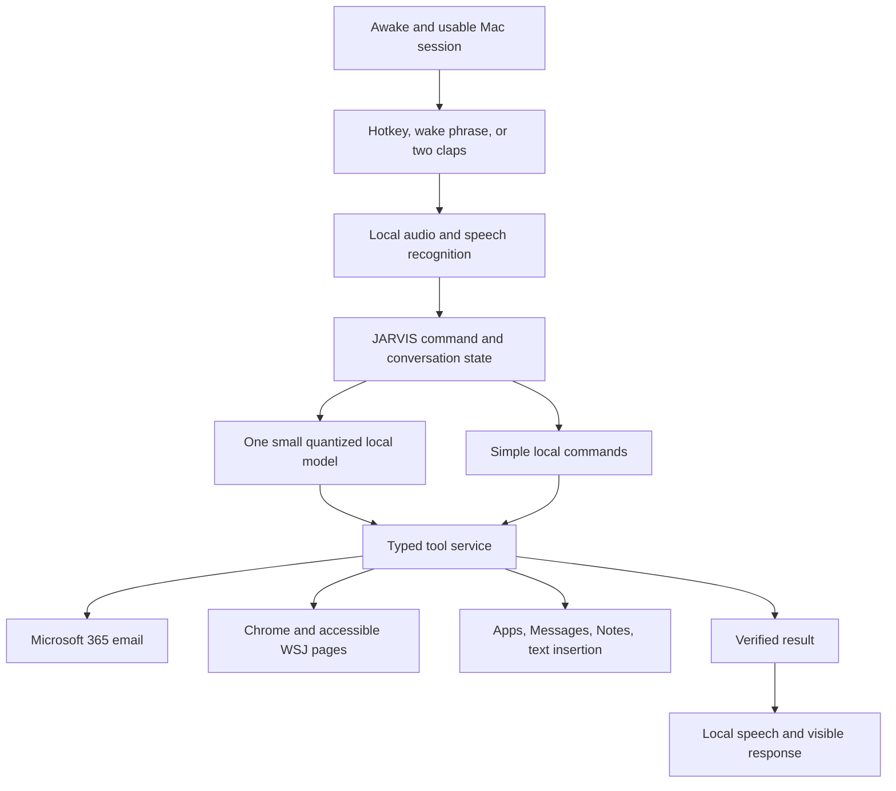

# Current implementation update — September 22, 2026

The user approved paid APIs after the original local-only plan. The installed configuration now targets Claude Sonnet 4.6 for conversation/summaries and TypeSafe Jev for validated app intents and observed browser-link choices. Keys are stored in macOS Keychain. Qwen remains an optional offline model. The female Samantha voice at 210 words per minute is approved and preserved.

A compact nonactivating command bar replaces the old dashboard. Apple on-device speech provides live previews, with local Whisper verifying finished commands. Clear app launches can begin during speech; writes and messages wait for the final utterance. Public market feeds now supply Indian and U.S. indices, BTC, official Fed/RBI rates and three dated market headlines.

Still outstanding: Microsoft 365 tenant/client registration and sign-in; full Jev browser form workflows and verified restaurant/food checkout; spoken interruption; broader real-room microphone and latency testing. The historical design below records earlier choices, some superseded by this update.

---

# JARVIS for your Mac — build plan and current status

Status (September 22, 2026): a local development app has been built and installed. The latest revision removes its dashboard and uses a native menu-bar Hands-free listening toggle. Local Whisper recognizes “Jarvis” after speech pauses; a separate wake-word network remains a possible optimization. No mailbox has been connected and no live messages have been sent by the implementation tests. Hardware observed: MacBook Pro, Apple M3, 8 GB memory, macOS 26.2. Outlook target: work/school Microsoft 365. No additional paid services or paid AI fallback. See README.md and docs/VERIFICATION.md for implemented behavior and actual test results; later sections retain future targets.

## Current interaction requirement

JARVIS runs in the background with a small native menu-bar icon. Launching it, clapping, or speaking does not open a dashboard or focus a JARVIS window. One menu-bar toggle enables hands-free commands. Optional native settings and a typed-command dialog appear only on request. The user continues working directly in Chrome, Outlook, Notes, Messages and other Mac apps.

Current implementation uses Swift/AppKit, whisper.cpp base.en, Qwen3.5:0.8b through local Ollama, a shared clap/speech detector, and typed in-process Mac actions. There is no MCP server or Browser Use runtime bundled yet. Its small browser adapter can read and follow permitted links on the current site. Core ML Laya is reviewed as an optional routing experiment; see docs/LAYA_COREML.md.

## The experience

Open and unlock the laptop. JARVIS becomes ready. Clap twice and it immediately says **“Welcome to the office, boss.”** It opens Outlook, gathers recent email and accessible WSJ coverage, and speaks a short briefing. Follow up naturally: “Summarize the second email,” “Open that article,” or “Make a note of the action items.”

The greeting is a fixed local speech response, independent of language-model loading or network availability. Begin fetching the briefing while the greeting plays. If retrieval is delayed, show progress; only speak email/news details once retrieved. Apply the trigger cooldown before speaking so the greeting cannot retrigger itself.

Other commands:

- “Jarvis, open Claude in Chrome.”
- “Switch to the WSJ tab.”
- “Type this into the current field…”
- “Make a note called Project ideas…”
- “Send an iMessage to [contact]: I’ll be there at six.”
- “Stop.”

The clap trigger operates while the Mac is awake and the user session is usable. It will not unlock the Mac or listen during system sleep. Launch-at-login and recovery after sleep are part of the app.

## What the reference repositories contribute

**FreeFlow: useful starting point for voice and dictation.** Reviewed commit [`ad5c827`](https://github.com/zachlatta/freeflow/tree/ad5c827b5a324c503d58f948d500fa5d9f90e7d8). Its Swift menu-bar app provides audio capture, configurable shortcuts, transcript cleanup, selection editing, app context, and clipboard insertion. It is MIT licensed. The default provider is Groq; custom/local compatible endpoints are supported, but this does not bundle a local speech model. Its source includes optional screenshot context and local pipeline history, which need deliberate settings in JARVIS. Reuse selected components with attribution in a separate JARVIS app. Add conversation, speech output, triggers, and tool execution.

**Laya: optional classification component.** Reviewed commit [`573e5b6`](https://github.com/NandhaKishorM/laya/tree/573e5b62696ba441230cd6be71d593331b5d23af). It returns choices, scores, and probabilities; it does not generate conversation or summaries. Potential later uses: categorizing email and routing a small set of command intents. The repository reports short input budgets and calibration/generalization limits; its T4 timings do not establish Mac performance. The runtime supports MPS but uses float32 on that path. Avoid preloading its multiple checkpoints on this 8 GB Mac. Start with explicit command routing and one small language model; add Laya only if a benchmark shows a useful improvement. Model confidence must not authorize actions.

These are source/documentation findings. Neither original project was installed or benchmarked. The first JARVIS implementation uses newly written Swift code rather than vendored FreeFlow code. The additional laya-coreml fork is reviewed separately in docs/LAYA_COREML.md; it is not loaded by the app.

## Local models without additional service fees

Benchmark Qwen3.5-0.8B and Qwen3.5-2B at 4-bit precision. Quantization reduces the storage used for weights; actual memory also includes runtime buffers, context/cache and other model components. It can affect output quality. A model that fits is not automatically fast enough for live conversation.

| Candidate | Published MLX weight file size | Intended role |
| --- | --- | --- |
| [Qwen3.5-0.8B 4-bit](https://huggingface.co/mlx-community/Qwen3.5-0.8B-4bit/tree/main) | 0.63 GB | Lowest-memory baseline; narrow commands and simple text |
| [Qwen3.5-2B 4-bit](https://huggingface.co/mlx-community/Qwen3.5-2B-4bit/tree/main) | 1.72 GB | Main candidate for short summaries and conversation |
| [Qwen3.5-4B 4-bit](https://huggingface.co/mlx-community/Qwen3.5-4B-4bit/tree/main) | 3.03 GB | Optional later experiment if normal apps retain enough memory |

These are downloaded weight sizes, not measured RAM use or performance guarantees. Sizes were checked against the repositories' file metadata. The listed multimodal MLX conversions document `mlx-vlm`; use the compatible runtime, or validate a text-only conversion. Do not assume every MLX model works interchangeably with `mlx-lm`.

Relevant projects:

- [llama.cpp](https://github.com/ggml-org/llama.cpp): quantized inference with native Apple Silicon/Metal support; good candidate for a packaged local runtime.
- [MLX LM](https://github.com/ml-explore/mlx-lm): Apple Silicon inference, quantization, bounded caches and configurable prompt processing. Benchmark compatible MLX and GGUF variants before selecting the runtime.
- [Microsoft BitNet](https://github.com/microsoft/BitNet): efficient inference for compatible models trained for very low precision. It does not turn arbitrary large models into equally capable tiny ones. Evaluate separately only if command/summary quality warrants it.
- [AirLLM](https://github.com/lyogavin/airllm): streams model layers to reduce GPU residency. Its own documentation identifies disk loading as a bottleneck. Low GPU-memory headlines do not describe total memory/storage needs or interactive performance on an 8 GB Mac. Exclude it from the initial voice loop.

The M3's CPU and GPU share the same 8 GB pool. Moving work between them does not create extra memory. Preserve memory for macOS, Chrome, Outlook and other normal applications. Use a small model, short requests, one generation at a time, and release idle models instead of trying to keep a 7B–70B model resident.

Small local models need narrower tasks than GPT-6. Familiar commands should call known app actions directly. Summarize one email/article chunk at a time and retain links to source text. More complex reasoning remains a quality limitation to measure rather than promise away.

Existing ChatGPT/Codex subscription access could be a separately enabled option later through the documented [app-server](https://learn.chatgpt.com/docs/app-server), subject to [account limits and billing rules](https://learn.chatgpt.com/docs/auth). It is not part of the default local path. Never fall back automatically to a billed API or purchased credits.

## Proposed components

| Component | Initial choice | Reason |
| --- | --- | --- |
| Mac app | Swift/SwiftUI menu-bar app with a compact conversation overlay | Native audio, lifecycle, Accessibility and app integration |
| Voice capture and dictation | Adapt FreeFlow components | Existing shortcut, recording and insertion behavior |
| Speech recognition | Local whisper.cpp; start with tiny.en/base.en | Keep microphone audio local and measure accuracy/latency before choosing |
| Wake phrase | Evaluate openWakeWord through ONNX | Pretrained “Hey Jarvis” exists; bare “Jarvis” needs a separate model/tuning |
| Two claps | Local audio transient detector with timing and cooldown | A simple trigger does not need a language model |
| Reasoning and summaries | One quantized local Qwen model, beginning with 0.8B/2B trials | No external model bill; choose by measured usefulness and memory |
| Spoken replies | macOS speech initially; evaluate Kokoro-82M for the desired voice | Native speech proves the loop; Kokoro offers open-weight speech synthesis |
| Tool interface | Local MCP service with narrow, typed actions | Gives the agent explicit capabilities and verifiable results |
| Notes and preferences | Apple Notes plus small local preference store | Familiar destination, limited persistent state |
| Optional model upgrade | Quantized Qwen3.5-4B trial only | Available memory and actual task quality decide suitability |

[whisper.cpp](https://github.com/ggml-org/whisper.cpp) supports Apple Silicon. [Kokoro-82M](https://huggingface.co/hexgrad/Kokoro-82M) and [Qwen3.5-4B](https://huggingface.co/Qwen/Qwen3.5-4B) publish Apache-2.0 model cards. [openWakeWord](https://github.com/dscripka/openWakeWord) has Apache-2.0 code, but its bundled wake-word models use CC BY-NC-SA 4.0; reassess that choice if distributing commercially. Mac packaging remains an integration test.

AI processing runs locally in the proposed default configuration. Microsoft 365, WSJ and iMessage still use their normal online services and existing accounts. macOS speech is a built-in proprietary component; Kokoro is the open-weight alternative. Load speech/model components as needed, keep contexts bounded, and measure memory pressure with Chrome and Outlook running.

## Integrations and their completion criteria

| Request | Implementation approach | What must be demonstrated |
| --- | --- | --- |
| Open Outlook and summarize mail | Launch Outlook; use delegated Microsoft Graph `Mail.Read` for content | Sign-in works with this tenant; summaries link to source messages and preserve dates/actions |
| Summarize a particular email | Resolve the requested message or current selection, then retrieve its content | Never guess which message is meant; report inaccessible content |
| WSJ briefing | Read articles accessible in the signed-in Chrome session through a narrowly scoped extension | Subscription content is actually available to the adapter; source URLs and publication times survive extraction |
| Open apps | NSWorkspace application lookup and activation | Correct installed app is focused; aliases map to known bundle IDs |
| Open Claude / switch Chrome tabs | Chrome scripting initially, extension for page interaction | Select exact tab by ID/title/URL; handle duplicate matches |
| Type dictated text | Accessibility and clipboard insertion | Intended field still has focus; preserve existing clipboard; do not automatically press Send/Return |
| Send iMessage | Contacts resolution plus Messages AppleScript | Exact recipient and body; no duplicate sends after a timeout; distinguish submitted from delivered |
| Make notes | Apple Notes scripting with returned note identifier | Note exists in the chosen folder with the expected text |

Microsoft documents [delegated mailbox access](https://learn.microsoft.com/en-us/graph/api/user-list-messages?view=graph-rest-1.0). Work/school sign-in may require tenant administrator consent. The mailbox connector must use an approved account route; restrictions must be surfaced as a setup requirement.

The installed Messages, Notes, and Chrome scripting dictionaries were inspected. They expose message sending, notes, and tabs respectively; that establishes an integration surface, not end-to-end success. A single explicit test message to a recipient chosen by the user is required before enabling routine sending.

For Chrome, a companion extension using [native messaging](https://developer.chrome.com/docs/extensions/develop/concepts/native-messaging) can access permitted pages in the existing signed-in profile. Keep login/cookies in Chrome. Validate WSJ access early: some pages may be unavailable to automation. If extraction fails, use article text explicitly shared by the user or WSJ newsletters already received; label the coverage accordingly. Newsletter summaries are not a substitute for articles that were never read. WSJ provides a [newsletter preference center](https://www.wsj.com/preference-center/newsletters).

## Behavior that makes it dependable

- Separate dictation mode from command mode. Quoted or dictated text must remain text.
- Run opening, focusing, reading and note creation immediately when the request is clear. A direct send command can authorize the resolved message; a draft request cannot. Ask only when recipient, content, or intent is ambiguous.
- Execute typed actions through the tool service, with result verification. Treat email/page content as source data, never as authority to run commands or send messages.
- Track an action ID and outcome for sends and note creation. After an ambiguous send result, check state or report uncertainty rather than blindly retrying.
- Allow “stop,” a keyboard cancel shortcut, and a visible microphone mute. Cancel pending work and speech promptly. Suppress self-triggering during speech output; test interruption behavior separately.
- Arm claps briefly after wake/session readiness, with configurable thresholds and cooldown. Track morning-briefing completion to prevent repeat briefings on every lid opening.
- Store service tokens in Keychain. Default to temporary audio buffers and minimal retained content. Keep source links for summaries. Audio, transcription and model processing remain local in the default mode.
- Request macOS microphone, Accessibility and Automation permissions during setup as needed. Request screen capture only when a feature needs it. Contacts access is needed only for contact-name lookup.
- Keep basic local actions available when the model is unloaded or unavailable. Show a clear resource/network status instead of silently switching to paid API calls.
- Bound each generation's context, output tokens and run time. Disable long thinking for routine tasks where supported; interrupt loops. The [Qwen3.5-2B model card](https://huggingface.co/Qwen/Qwen3.5-2B) specifically notes possible thinking loops, so short interactive tasks need bounded execution.
- Compare memory pressure and swap growth against an idle baseline with normal apps open. Reduce context/model size, unload idle weights, or pause inference when pressure rises. Target an approximately 3 GB or lower active AI footprint initially, but treat this as a budget to validate, not measured usage. Do not change system memory limits to force a larger model to fit.

## Build order

1. **Prove local performance and account access.** Compare 0.8B and 2B quantized models on synthetic commands and email summaries with Chrome/Outlook running. Record peak memory, memory pressure, swap growth, first-response delay, generation speed, command accuracy and summary faithfulness. Try a small speech model and test cancellation. Choose a model/runtime only after the machine stays responsive. Prove Microsoft 365 sign-in and WSJ content access separately.
2. **Deliver the useful voice assistant.** Background menu-bar service, hands-free toggle, local transcription, bounded local conversation, spoken replies, open apps, switch tabs, create notes, and type into a chosen field. Keep native menu-bar status, access to the last response, and a stop control. Do not introduce a dashboard.
3. **Deliver the morning briefing.** Outlook retrieval, focused email summaries, accessible WSJ coverage, source links, short spoken briefing, and follow-up questions. Start with a “Brief me” button/hotkey, then connect the clap trigger.
4. **Add messaging and hands-free activation.** Contact disambiguation, explicit iMessage sending, wake phrase, calibrated double-clap detection, startup behavior, sleep recovery, and interruption handling. Begin with “Hey Jarvis”; evaluate bare “Jarvis” against accidental activation.
5. **Tune from actual use.** Measure latency and battery impact; improve the voice; evaluate Laya, BitNet or a larger quantized model only where they solve a measured problem within the same resource budget.

Acceptance checks cover both success and failure: correct target app/field, duplicate contact names, expired sign-in, denied permissions, locked/asleep Mac, noisy audio, lost network, unavailable WSJ pages, memory pressure, generation loops, and repeated triggers. Test summaries against source messages/articles; test actions against observed outcomes. Record latency under normal use rather than promising a response time from model benchmark numbers.

## First implementation target

A menu-bar JARVIS that accepts a hotkey command, transcribes locally, uses a small local model, speaks back, and can open Claude in Chrome and create an Apple Note. It uses no paid model endpoints. This validates the whole interaction loop and laptop responsiveness before adding mailbox/news access and unattended listening.
